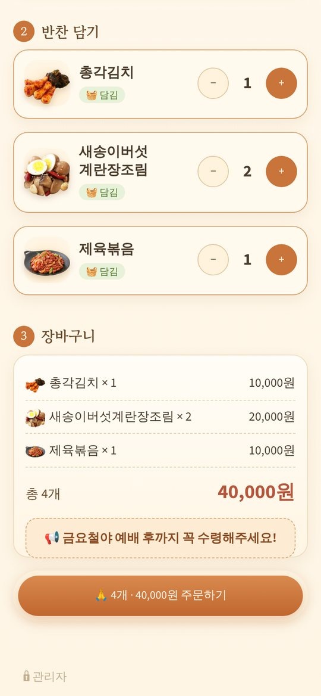
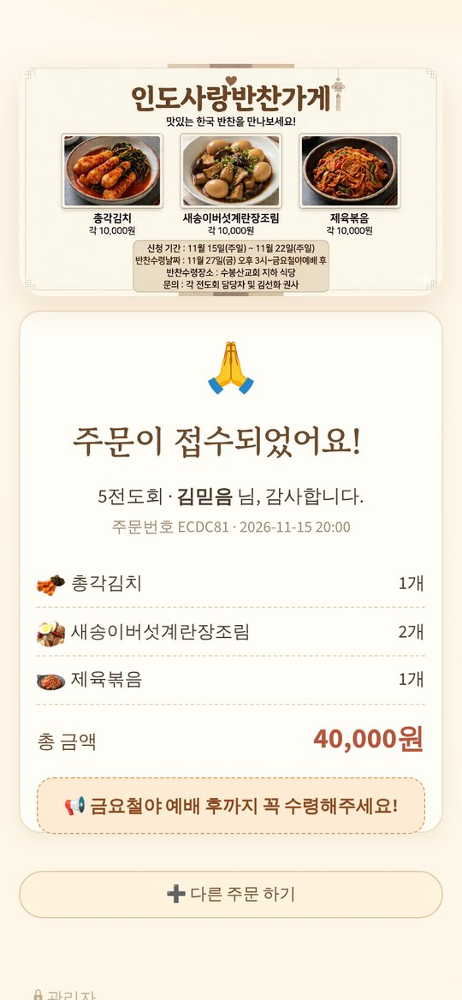
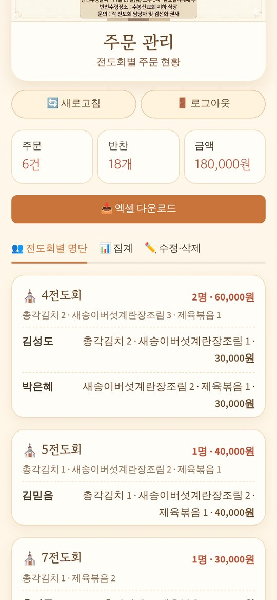

# 🍱 인도사랑 반찬가게

휴대폰에서 반찬을 주문하는 Streamlit 앱입니다.

## 배경 및 목적
인도 선교를 위한 반찬 사역을 돕기 위해, 성도들이 휴대폰으로 쉽게 반찬을 주문할 수 있도록 만들었습니다.

## 화면
| ① 주문자 입력 | ② 반찬 담기·장바구니 | ③ 주문 접수 | ④ 관리자 |
|:---:|:---:|:---:|:---:|
|  |  |  |  |
| 전도회·이름 입력 (필수) | **+ / −** 로 담기, 합계 자동 계산 | 주문번호와 수령 안내 | 전도회별 명단·집계·엑셀 |

## 기능
- **주문:** 전도회·이름(필수) 입력 → 반찬 담기 → 주문하기 (1개 10,000원)
- **관리자:** 화면 맨 아래 🔒 관리자 → 전도회별 명단·집계, 주문 수정·삭제, 엑셀 다운로드

## 주문 보관 (구글 시트)
주문은 구글 시트에 한 줄씩 저장됩니다. 연결 전에는 서버 임시 파일에 저장되어 앱이 재시작되면 지워질 수 있습니다.

1. 구글 시트를 새로 만들고 **확장 프로그램 → Apps Script**에 `tools/google_sheet_script.gs` 내용을 붙여넣기
2. 맨 위 `TOKEN` 값을 아무도 모르는 긴 문자로 바꾸기
3. **배포 → 새 배포 → 웹 앱** (실행: 나, 액세스: 모든 사용자) → 웹 앱 URL 복사
4. Streamlit Cloud → Settings → **Secrets**에 추가
```toml
SHEET_URL = "복사한 웹 앱 URL"
SHEET_TOKEN = "2번에서 정한 문자"
```
