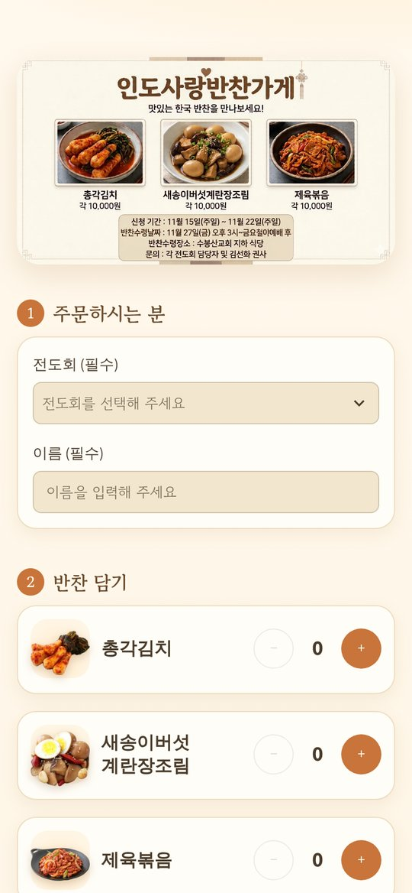

# 🍱 인도사랑 반찬가게

휴대폰에서 반찬을 주문하는 Streamlit 앱입니다.

## 배경 및 목적
인도 선교를 위한 반찬 사역을 돕기 위해, 성도들이 휴대폰으로 쉽게 반찬을 주문할 수 있도록 만들었습니다.

## 화면
| ① 주문자 입력 | ② 반찬 담기·장바구니 | ③ 주문 접수 | ④ 관리자 |
|:---:|:---:|:---:|:---:|
|  |  |  |  |
| 전도회·이름 입력 (필수) | **+ / −** 로 담기, 합계 자동 계산 | 주문번호와 수령 안내 | 전도회별 명단·집계·엑셀 |

## 기능
- **주문:** 전도회·이름(필수) 입력 → 반찬 담기 → 주문하기 (1개 10,000원)
- **관리자:** 화면 맨 아래 🔒 관리자 → 전도회별 명단·집계, 주문 수정·삭제, 엑셀 다운로드

## 주문 보관 (GitHub)
주문이 들어올 때마다 **비공개 저장소의 `orders.csv`에 한 줄씩 커밋**됩니다. 앱이 재시작돼도 지워지지 않고, 커밋 기록이 곧 주문 로그입니다.

1. GitHub에 **비공개(Private)** 저장소 만들기 (`banchan-jumun`) — 이름이 공개되지 않도록 꼭 비공개로
2. GitHub → Settings → Developer settings → **Fine-grained tokens** → Generate new token
   - Repository access: `banchan-jumun`만 선택
   - Permissions → Repository → **Contents: Read and write**
3. Streamlit Cloud → Settings → **Secrets**에 추가
```toml
GITHUB_TOKEN = "github_pat_..."
GITHUB_REPO = "shinjihuu/banchan-jumun"
```
- 내려받기: 관리자 화면의 **주문 파일 보기** 링크 → GitHub에서 Download (또는 관리자 화면 엑셀 다운로드)
